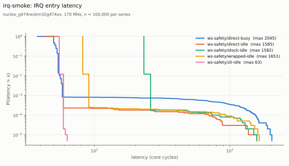

Your first experiment
=====================

.. admonition:: Prerequisites

   The lab space of :doc:`set-up-a-lab-space`, with the tree ``ws-safety``
   and a wire check that gives ``RESULT: OK``.

An :term:`experiment` is a file ``experiment.yaml``: an app, the trees and
the points to measure. In this tutorial you run the experiment
``irq-smoke`` once with ``run.py`` alone, outside a study, and you look at
what it makes. The commands run in the lab folder.

See the points
--------------

``--dry-run`` checks the repository and the trees and lists the points.
It builds nothing:

.. code-block:: console

   $ safety/scripts/benchmarks/run.py safety/validation/empirical/latencies/st-default-latencies/st-irq-entry/ex-irq-smoke/experiment.yaml --dry-run
   safety 7004a897b2cc  trees ws-safety  5 points x 1
     stock-idle: {'LATBENCH_IRQ_PATH_STOCK': 'y'} [] []
     wrapped-idle: {'LATBENCH_IRQ_PATH_WRAPPED': 'y'} [] []
     direct-idle: {'LATBENCH_IRQ_PATH_DIRECT': 'y'} [] []
     zli-idle: {'LATBENCH_IRQ_PATH_ZLI': 'y'} [] []
     direct-busy: {'LATBENCH_IRQ_PATH_DIRECT': 'y', 'LATBENCH_BG_BUSY': 'y'} [] []

Each :term:`point` is one build of the app with these Kconfig values. The
four IRQ paths run on an idle CPU, and the direct path also on a busy CPU.

Run it
------

``--out`` names the parent folder of the run: the run folder is
``<out>/<experiment>/<UTC time>/``. The run takes about five minutes. It
builds each point, flashes the board and reads 100000 samples:

.. code-block:: console

   $ safety/scripts/benchmarks/run.py safety/validation/empirical/latencies/st-default-latencies/st-irq-entry/ex-irq-smoke/experiment.yaml --out tryout
   safety 7004a897b2cc  trees ws-safety  5 points x 1
   [...]
   board nucleo_g474re: probe 0042003F3433510A37363934 (STLINK-V3), console /dev/serial/by-id/usb-STMicroelectronics_STLINK-V3_0042003F3433510A37363934-if02
   run folder /wrk/z/lab-tutorial/tryout/irq-smoke/20261028T010550Z
   [ws-safety/stock-idle] build
   [ws-safety/stock-idle] rep 1
   [...]
   [ws-safety/direct-busy] build
   [ws-safety/direct-busy] rep 1
                               log     path  background  hist       n  min  p50  p90  p99  p99.9  p99.99   max    mean     sd  ovf  inv
     ws-safety/stock-idle/rep1.log    stock        idle   irq  100000  232  232  232  260    260     738  1582  232.46  11.04    0    0
   ws-safety/wrapped-idle/rep1.log  wrapped        idle   irq  100000   82   82   82   91     91     921  1651   82.28  13.62    0    0
    ws-safety/direct-idle/rep1.log   direct        idle   irq  100000   43   55   55   59     59     694  1585   55.17  10.57    0    0
       ws-safety/zli-idle/rep1.log      zli        idle   irq  100000   54   55   55   59     59      59    63   55.04   0.44    0    0
    ws-safety/direct-busy/rep1.log   direct        busy   irq  100000   38   50   54   56     58    1543  2045   51.94  28.73    0    0

   images: 0 of 5 from the build cache
   results in /wrk/z/lab-tutorial/tryout/irq-smoke/20261028T010550Z  (sha256:3f21928bcd47d0b4a5f5e81341e6d10b81649e6d68dce67c07be947c7b926509)

The table has one row for each point: the axes (``path``,
``background``) and the percentiles of the IRQ entry latency in core
cycles. The last line gives the :term:`seal` digest of the run.

Look at the run folder
----------------------

.. code-block:: console

   $ find tryout/irq-smoke/20261028T010550Z -maxdepth 3 | sort
   tryout/irq-smoke/20261028T010550Z
   tryout/irq-smoke/20261028T010550Z/manifest.json
   tryout/irq-smoke/20261028T010550Z/summary.txt
   tryout/irq-smoke/20261028T010550Z/ws-safety
   tryout/irq-smoke/20261028T010550Z/ws-safety/direct-busy
   tryout/irq-smoke/20261028T010550Z/ws-safety/direct-busy/.config
   tryout/irq-smoke/20261028T010550Z/ws-safety/direct-busy/build.log
   tryout/irq-smoke/20261028T010550Z/ws-safety/direct-busy/irq_latency-ws-safety-direct-busy.elf
   tryout/irq-smoke/20261028T010550Z/ws-safety/direct-busy/irq_latency-ws-safety-direct-busy.hex
   tryout/irq-smoke/20261028T010550Z/ws-safety/direct-busy/rep1.log
   tryout/irq-smoke/20261028T010550Z/ws-safety/direct-busy/zephyr.dts
   [...]

Each point folder has the image (named after the app, the tree and the
point), the ``.config``, the devicetree, the build log and the serial log
of each repetition. ``manifest.json`` records where everything came from:

.. code-block:: console

   $ python3 -m json.tool tryout/irq-smoke/20261028T010550Z/manifest.json | head -20
   {
       "experiment": "irq-smoke",
       "experiment_file": "validation/empirical/latencies/st-default-latencies/st-irq-entry/ex-irq-smoke/experiment.yaml",
       [...]
       "safety": {
           "path": "/wrk/z/lab-tutorial/safety",
           "rev": "7004a897b2cc030c541077e8efea32ec97399854",
           "ref": "refs/latbench/run/irq-smoke/20261028T010550Z",
           "bench_tree": "07bc9f50bbfcebb8bbac55714bcbe867296d34de",
           "bench_tree_kind": "firmware/1",
           "module_tree": "0f8dd9da43bb60aba06c67e2183156b4ffcd7e17"

The commit of the safety repository, the pins of the trees, the SDK, the
tools and the CMake command of each point are in the manifest (see
:doc:`../reference/files/results-tree`). The ref
``refs/latbench/run/irq-smoke/<UTC>`` keeps the commit in the clone, so
you can build the run again later (:doc:`audit-a-result`).

Plot the distributions
----------------------

.. code-block:: console

   $ safety/scripts/benchmarks/plot.py ccdf --out irq-smoke-ccdf.svg --title "irq-smoke: IRQ entry latency" tryout/irq-smoke/20261028T010550Z/ws-safety/*/rep1.log && echo plotted
   saved irq-smoke-ccdf.svg
   plotted

   The share of the samples at or above each latency (an example; your
   values are different). The floor, the modes and the tail of each point
   are in one chart.

A run with ``--out`` outside a study is a try-out: no study reads it. The
next tutorial runs the same experiment as part of its study.
:doc:`../reference/cli/run-py` gives all options of ``run.py``, and
:doc:`../reference/cli/scripts` those of ``plot.py`` and ``latbench.py``.

Next: :doc:`first-campaign`.
